

  

<h1 align="center">TopBar</h1>

  A free, single-file Windows app that brings a Mac-style menu bar, Spotlight search, desktop widgets, a floating taskbar, and 22 built-in apps to Windows 10 and 11. 
  Free forever · One small file · No installer · No account

  <a href="https://github.com/jesse-delman/topbar/raw/main/TopBar.exe"><picture><source media="(prefers-color-scheme: dark)" srcset="assets/download-dark.svg">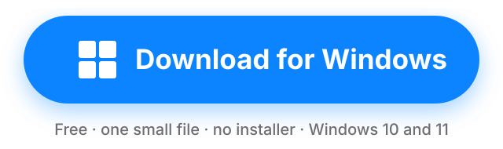</picture></a>

 

  <picture><source media="(prefers-color-scheme: dark)" srcset="assets/hero-dark.svg"></picture>

 

## What it replaces

  <picture><source media="(prefers-color-scheme: dark)" srcset="assets/replaces-dark.svg"></picture>

 

## Built-in apps &amp; features

Press the **Windows key** or **Alt + Space** to open Spotlight Search for apps, instant file search, math, unit conversions, clipboard history, and 1,400+ commands — or launch any of the 22 built-in tools below:

<table>
  <tr>
    <td align="center" width="25%" valign="top"> <picture><source media="(prefers-color-scheme: dark)" srcset="assets/icons/app00d.png">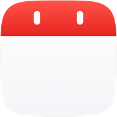</picture> <b>Calendar</b> Schedule, agenda &amp; live date  </td>
    <td align="center" width="25%" valign="top"> <picture><source media="(prefers-color-scheme: dark)" srcset="assets/icons/app01d.png">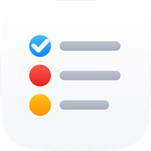</picture> <b>Reminders</b> Checklists, flags &amp; repeats  </td>
    <td align="center" width="25%" valign="top"> <picture><source media="(prefers-color-scheme: dark)" srcset="assets/icons/app02d.png"></picture> <b>Clock</b> World clocks, alarms &amp; timers  </td>
    <td align="center" width="25%" valign="top"> <picture><source media="(prefers-color-scheme: dark)" srcset="assets/icons/app03d.png">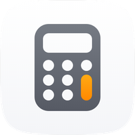</picture> <b>Calculator</b> Fast math right from desktop  </td>
  </tr>
  <tr>
    <td align="center" width="25%" valign="top"> <picture><source media="(prefers-color-scheme: dark)" srcset="assets/icons/app04d.png">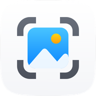</picture> <b>Screenshot</b> Instant region &amp; window capture  </td>
    <td align="center" width="25%" valign="top"> <picture><source media="(prefers-color-scheme: dark)" srcset="assets/icons/app05d.png">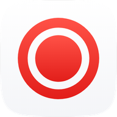</picture> <b>Screen Recorder</b> Live preview &amp; audio mixer  </td>
    <td align="center" width="25%" valign="top"> <picture><source media="(prefers-color-scheme: dark)" srcset="assets/icons/app06d.png"></picture> <b>TopBar Settings</b> Mac-organized preferences  </td>
    <td align="center" width="25%" valign="top"> <picture><source media="(prefers-color-scheme: dark)" srcset="assets/icons/app07d.png"></picture> <b>Widgets</b> Weather, notes, stats &amp; more  </td>
  </tr>
  <tr>
    <td align="center" width="25%" valign="top"> <picture><source media="(prefers-color-scheme: dark)" srcset="assets/icons/app08d.png">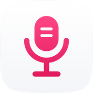</picture> <b>Mic &amp; Sound</b> Clean mic control &amp; effects  </td>
    <td align="center" width="25%" valign="top"> <picture><source media="(prefers-color-scheme: dark)" srcset="assets/icons/app09d.png">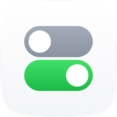</picture> <b>Control Center</b> Wi-Fi, display &amp; quick toggles  </td>
    <td align="center" width="25%" valign="top"> <picture><source media="(prefers-color-scheme: dark)" srcset="assets/icons/app10d.png">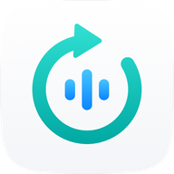</picture> <b>Loop</b> Instant audio loop station  </td>
    <td align="center" width="25%" valign="top"> <picture><source media="(prefers-color-scheme: dark)" srcset="assets/icons/app11d.png">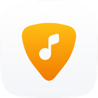</picture> <b>Guitar Tabs</b> Song tabs &amp; chord sheets  </td>
  </tr>
  <tr>
    <td align="center" width="25%" valign="top"> <picture><source media="(prefers-color-scheme: dark)" srcset="assets/icons/app12d.png">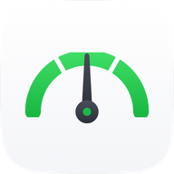</picture> <b>Tuner</b> Real-time instrument tuner  </td>
    <td align="center" width="25%" valign="top"> <picture><source media="(prefers-color-scheme: dark)" srcset="assets/icons/app14d.png"></picture> <b>Wallpapers</b> 4K daily, search &amp; live scenes  </td>
    <td align="center" width="25%" valign="top"> <picture><source media="(prefers-color-scheme: dark)" srcset="assets/icons/app15d.png">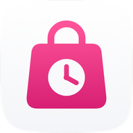</picture> <b>Clock Store</b> Desktop &amp; Rainmeter clock skins  </td>
  </tr>
  <tr>
    <td align="center" width="25%" valign="top"> <picture><source media="(prefers-color-scheme: dark)" srcset="assets/icons/app16d.png"></picture> <b>Feedback</b> Direct replies inside TopBar  </td>
    <td align="center" width="25%" valign="top"> <picture><source media="(prefers-color-scheme: dark)" srcset="assets/icons/app18d.png"></picture> <b>TopBar Apps</b> All built-in apps in one grid  </td>
    <td align="center" width="25%" valign="top"> <picture><source media="(prefers-color-scheme: dark)" srcset="assets/icons/app19d.png"></picture> <b>Game Library</b> Steam, Epic, Xbox, Riot &amp; more  </td>
    <td align="center" width="25%" valign="top"> <picture><source media="(prefers-color-scheme: dark)" srcset="assets/icons/app20d.png"></picture> <b>Notifications</b> Unified Notification Center  </td>
  </tr>
  <tr>
    <td align="center" width="25%" valign="top"> <picture><source media="(prefers-color-scheme: dark)" srcset="assets/icons/app21d.png"></picture> <b>Shortcuts</b> 600+ action automations (Beta)  </td>
    <td align="center" width="25%" valign="top"> <picture><source media="(prefers-color-scheme: dark)" srcset="assets/icons/app22d.png">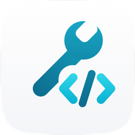</picture> <b>Developer Tools</b> Test notifications, replies &amp; updates  </td>
    <td width="25%"></td>
    <td width="25%"></td>
  </tr>
</table>

Also included: **Dynamic Island** (`Beta`) at the top of your screen for live music, timers, calls, and recordings, plus a **Ctrl + Shift + G** Game Overlay with FPS, 1% / 0.1% lows, frame times, and GPU/CPU stats.

 

## Speed &amp; memory

  <picture><source media="(prefers-color-scheme: dark)" srcset="assets/perf-dark.svg">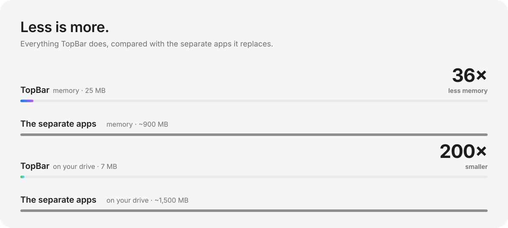</picture>

 

## Install

  <picture><source media="(prefers-color-scheme: dark)" srcset="assets/install-dark.svg">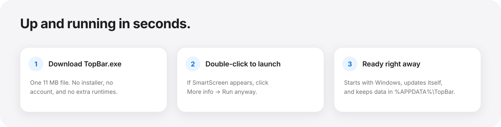</picture>

  <a href="https://github.com/jesse-delman/topbar/raw/main/TopBar.exe"><picture><source media="(prefers-color-scheme: dark)" srcset="assets/download-btn-dark.svg"></picture></a>

 

## Frequently asked questions

<b>Why did Windows SmartScreen or my antivirus warn me?</b>

 
TopBar is a free, independent app and is not code-signed with a paid commercial certificate, so Windows SmartScreen may show <i>"Windows protected your PC"</i> on first launch. Click <b>More info</b>, then <b>Run anyway</b> to open it.

<b>Where is my data stored?</b>

 
Everything stays locally on your PC in <code>%APPDATA%\TopBar</code> — settings, notes, reminders, calendars, shortcuts, and wallpapers. No account is required.

<b>How do updates work?</b>

 
TopBar checks for updates automatically and installs them quietly while you are away. You can also type <b>update</b> in Spotlight Search any time to check right away.

<b>How do I request a feature or report a bug?</b>

 
Open <b>Help › Feedback</b> or type <b>feedback</b> in Search. Messages go straight to the developer, and replies show up right inside TopBar.

<b>How do I uninstall TopBar?</b>

 
Quit TopBar from its menu bar and delete <code>TopBar.exe</code>. If you also want to clear saved settings and notes, delete <code>%APPDATA%\TopBar</code>.

<b>Credits &amp; third-party components</b>

 
<ul>
  <li>Built and maintained by the developer.</li>
  <li>Text is set in <a href="https://rsms.me/inter/">Inter</a> by Rasmus Andersson (SIL Open Font License 1.1).</li>
  <li>Guitar Tabs uses <a href="https://github.com/spotify/basic-pitch">Basic Pitch</a> by Spotify (Apache License 2.0) and Demucs (downloaded on first use).</li>
  <li>Wallpapers are sourced from <a href="https://wallhaven.cc">Wallhaven</a> and Bing. Clock Store skins belong to their respective authors.</li>
  <li>Memory and size comparisons are approximate and vary by system.</li>
</ul>

