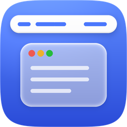
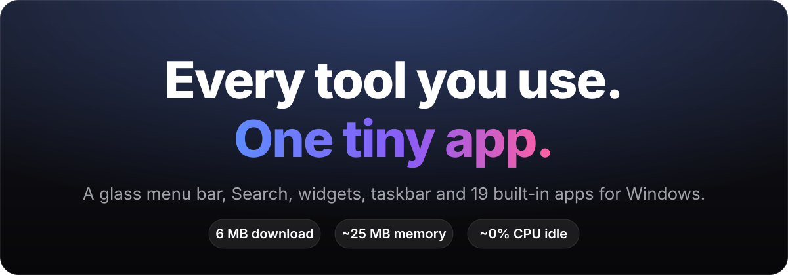
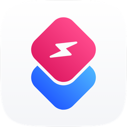
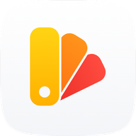
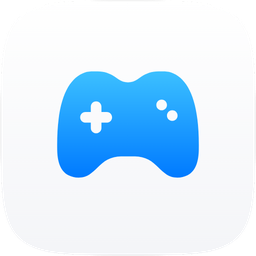
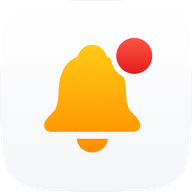
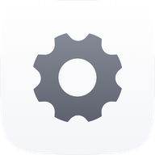
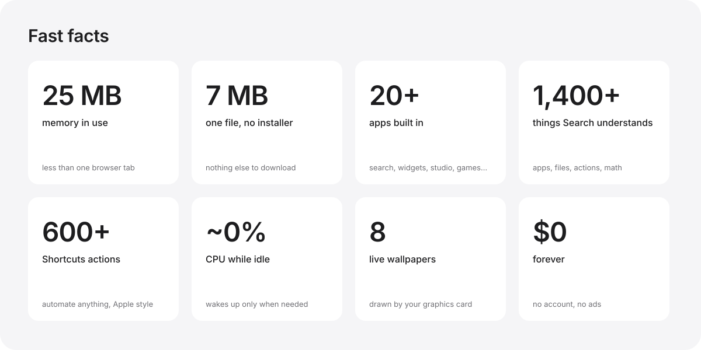

<h1 align="center">TopBar</h1>

Every tool you use. One tiny app. For Windows 10 and 11 · free · no installer

<picture><source media="(prefers-color-scheme: dark)" srcset="assets/hero-dark.svg"></picture>

<picture><source media="(prefers-color-scheme: dark)" srcset="assets/icons/app02d.png"></picture>&nbsp;<picture><source media="(prefers-color-scheme: dark)" srcset="assets/icons/app00d.png"></picture>&nbsp;<picture><source media="(prefers-color-scheme: dark)" srcset="assets/icons/app21d.png"></picture>&nbsp;<picture><source media="(prefers-color-scheme: dark)" srcset="assets/icons/app14d.png"></picture>&nbsp;<picture><source media="(prefers-color-scheme: dark)" srcset="assets/icons/app19d.png"></picture>&nbsp;<picture><source media="(prefers-color-scheme: dark)" srcset="assets/icons/app13d.png"></picture>&nbsp;<picture><source media="(prefers-color-scheme: dark)" srcset="assets/icons/app11d.png"></picture>&nbsp;<picture><source media="(prefers-color-scheme: dark)" srcset="assets/icons/app12d.png"></picture>&nbsp;<picture><source media="(prefers-color-scheme: dark)" srcset="assets/icons/app07d.png"></picture>&nbsp;<picture><source media="(prefers-color-scheme: dark)" srcset="assets/icons/app20d.png"></picture>&nbsp;<picture><source media="(prefers-color-scheme: dark)" srcset="assets/icons/app06d.png"></picture>

 

<picture><source media="(prefers-color-scheme: dark)" srcset="assets/facts-dark.svg"></picture>

<picture><source media="(prefers-color-scheme: dark)" srcset="assets/perf-dark.svg"></picture>

<picture><source media="(prefers-color-scheme: dark)" srcset="assets/replaces-dark.svg"></picture>

 

## What's inside

**Search.** Press the Windows key or Alt + Space. Apps, every file on your PC the moment it's saved, settings, math, units, timers, music and more than 1,400 commands. Round buttons narrow it to apps, files, shortcuts or your clipboard.

**Shortcuts** `BETA`. Build your own automations from 600+ actions: text, math, files, windows, keys, media, web and every Search command. Run them from Search, a key, or let them start by themselves at a time, when an app opens, when you plug in, join Wi-Fi or a file lands in a folder.

**Wallpapers.** Thousands of free wallpapers searched as you type, Bing's daily photo in 4K, and live wallpapers drawn by your graphics card that follow your pointer and rest when a window covers them. Save your whole desktop look as a preset and switch back any time.

**Menu bar and taskbar.** The app you're in and its menus, time, CPU, memory, Wi-Fi, volume per app, battery and music. A glass taskbar you can shape: alignment, roundness, see-through, magnify on hover, app names, badges.

**Widgets.** Clocks, weather, calendar, notes, music, stats, photos, timers, app launchers and Rainmeter clocks on your desktop.

**Dynamic Island** `BETA`. A pill at the top for music, calls, timers, recording and every TopBar event, so nothing slips by.

**Games.** Ctrl + Shift + G for FPS with averages, 1% and 0.1% lows, frame times, GPU and CPU, and how much memory the game uses. A Game Library with every game from Steam, Epic, GOG, Ubisoft, Xbox, EA, Battle.net and Riot.

**Studio** `BETA`. A real multi-track editor in glass: media pool, viewer with scopes and safe zones, inspector, and a timeline with video, caption and audio tracks. Blade, trim, slip, ripple, keyframes, transitions, titles, captions, green screen, masks, blend modes, layouts, colour grading with LUTs and colour matching, beat cutting, music that dips under voices, and export to MP4, HEVC, GIF, WAV, PNG or SRT.

**And more.** Voice changer with realistic voices and a virtual mic, soundboard, notes, screenshots and recording, guitar tabs, tuner and looper, calendar, reminders, clock, calculator, Notification Center, mini player and Power Tools.

## Get it

1. Download **[TopBar.exe](https://github.com/jesse-delman/topbar/raw/main/TopBar.exe)**.
2. Double-click it. A short tour shows you around.

> Windows may say "Windows protected your PC" the first time, because the app is new. Click **More info**, then **Run anyway**.

It starts with Windows and updates itself.

## Ask for anything

Send feedback any time, about anything: a feature, a whole new app, a tiny fix. Every message is read, updates usually come out within hours, and **you get a reply right inside TopBar**. Open **Help › Feedback** or type **feedback** in Search.

<b>Good to know</b>

- **Runs on** Windows 10 and 11.
- **Your data** stays on your PC, in `%APPDATA%\TopBar`.
- **Updates** install by themselves while you're away; type **update** in Search to check now.
- **FPS in the game overlay** asks Windows once for permission to read graphics events (one "Yes"), the same way Game Bar does.
- **Remove it**: quit TopBar from its menu and delete `TopBar.exe`.
- The memory and size comparisons are approximate and vary from PC to PC.

<b>Credits</b>

- Made by the developer.
- Guitar Tabs uses [Basic Pitch](https://github.com/spotify/basic-pitch) by Spotify (Apache License 2.0), Demucs (htdemucs, downloaded on first use) and the songsterr-ai lead-guitar pipeline.
- Wallpapers come from [Wallhaven](https://wallhaven.cc) and Bing. Clock Store skins are made by their own authors and shared on GitHub.

