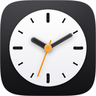
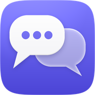
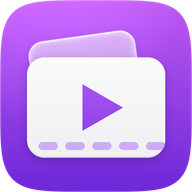
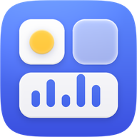
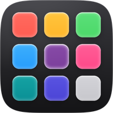
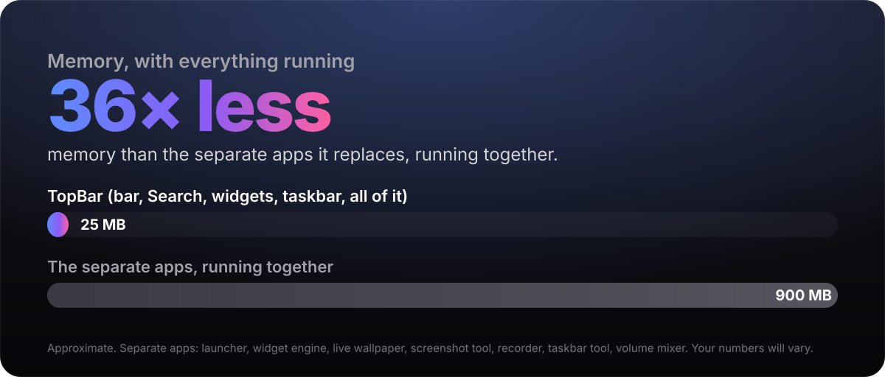
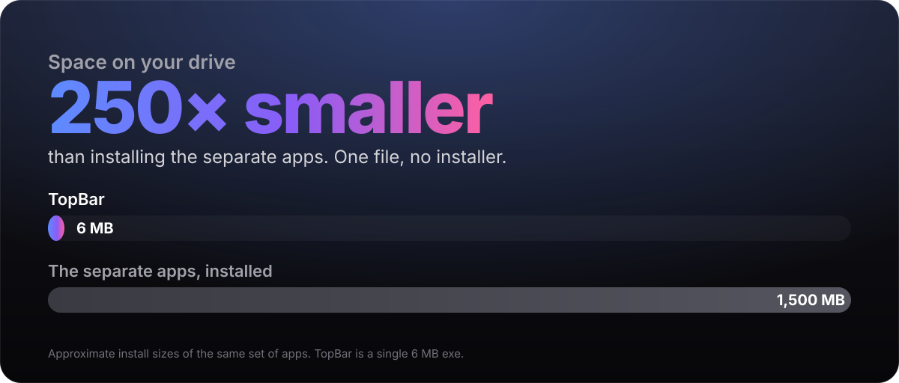
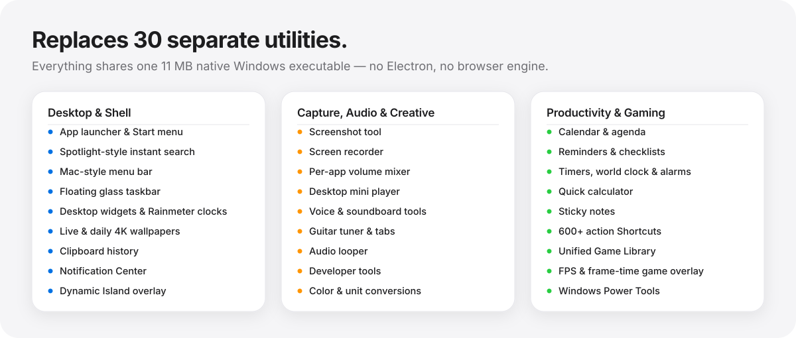

<h1 align="center">TopBar</h1>

<b>The one app that replaces the other twenty.</b> A glass menu bar, Search, widgets, a taskbar and 19 built-in apps for Windows 10 and 11.

<picture><source media="(prefers-color-scheme: dark)" srcset="assets/icons/app02d.png"></picture>&nbsp;<picture><source media="(prefers-color-scheme: dark)" srcset="assets/icons/app00d.png"></picture>&nbsp;<picture><source media="(prefers-color-scheme: dark)" srcset="assets/icons/app16d.png"></picture>&nbsp;<picture><source media="(prefers-color-scheme: dark)" srcset="assets/icons/app11d.png"></picture>&nbsp;<picture><source media="(prefers-color-scheme: dark)" srcset="assets/icons/app12d.png"></picture>&nbsp;<picture><source media="(prefers-color-scheme: dark)" srcset="assets/icons/app13d.png"></picture>&nbsp;<picture><source media="(prefers-color-scheme: dark)" srcset="assets/icons/app07d.png"></picture>&nbsp;<picture><source media="(prefers-color-scheme: dark)" srcset="assets/icons/app06d.png"></picture>&nbsp;<picture><source media="(prefers-color-scheme: dark)" srcset="assets/icons/app18d.png"></picture>&nbsp;

---

## Light enough to forget it's there

Most "all-in-one" apps are a browser in disguise. TopBar is a single native exe, drawn by hand, with no frameworks underneath. Everything below runs at the same time and still uses less memory than one browser tab.

---

## Everything, in one place

| | |
|---|---|
| 🔎 **Search** | **Alt + Space**, then type anything: apps, files (found the moment they're saved), settings, math, units, timers, music, and hundreds of commands. **Ctrl + P** pins anything to the top. |
| 🪟 **Menu bar** | The app you're in and its menus, the time, CPU, memory, Wi-Fi, volume (with a slider for every app), battery and music. On every screen. |
| 🧩 **Widgets** | Clocks, weather, calendar, notes, music, stats, photos, timers and Rainmeter clocks, right on your desktop. |
| 📝 **Notes** | Tabs, checklists, bold, headings, links and spoilers like Discord, with spell check. |
| 🎮 **Game overlay** | **Ctrl + Shift + G**: CPU, memory, GPU load and temperature and network in a corner, or on by itself when a game goes fullscreen. |
| 📺 **Mini player** | **Ctrl + Alt + P** floats any window (a video, a stream, a call) in a small always-on-top player while you play. |
| 📸 **Screenshots & recording** | **Print Screen** copies it right away; mark it up, blur anything in squares or circles. Record the screen with sound. |
| 🎸 **Guitar** | Tabs from any song file, a tuner for any instrument and tuning, and a looper. |
| 🧱 **Taskbar & Start** | A glass taskbar you can reorder by dragging, and TopBar's own Start menu with your apps and Steam games. |
| ⌨️ **Your shortcuts** | Give any app its own hotkey, like **Ctrl + D** for Discord (Settings › Keyboard). |
| 📱 **Phone Link** | Files and copied text between your phone and PC, by QR code. No phone app. |
| 🖼️ **Live wallpaper** | Any video as your wallpaper, paused whenever a window covers it. |

Plus Calendar, Reminders, Clock, Calculator, Mic & Sound, Control Center, Clock Store, Studio and a shake-the-mouse menu. Everything can be changed in **Settings**.

---

## Get it

1. Download **[TopBar.exe](https://github.com/jesse-delman/topbar/raw/main/TopBar.exe)**.
2. Double-click it. A short tour shows you around.

> Windows may say "Windows protected your PC" the first time, because the app is new. Click **More info**, then **Run anyway**.

No installer, no account, no ads. It starts with Windows and updates itself.

---

## Ask for anything

Send feedback any time, about anything: a feature, a whole new app, a tiny fix. Every message is read, updates usually come out within hours, and **you get a reply right inside TopBar**. Open **Help › Feedback** or type **feedback** in Search.

<b>Good to know</b>

- **Runs on** Windows 10 and 11.
- **Your data** stays on your PC, in `%APPDATA%\TopBar`.
- **Updates** install by themselves while you're away; type **update** in Search to check now.
- **Remove it**: quit TopBar from its menu and delete `TopBar.exe`.
- The memory and size comparisons are approximate and vary from PC to PC.

<b>Credits</b>

- Made by the developer.
- Guitar Tabs uses [Basic Pitch](https://github.com/spotify/basic-pitch) by Spotify (Apache License 2.0), Demucs (htdemucs, downloaded on first use) and the songsterr-ai lead-guitar pipeline.
- Clock Store skins are made by their own authors and shared on GitHub.

